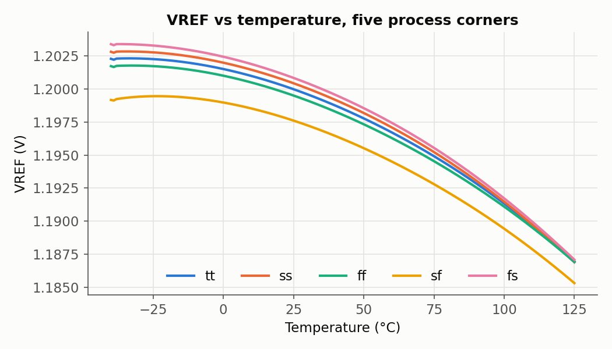
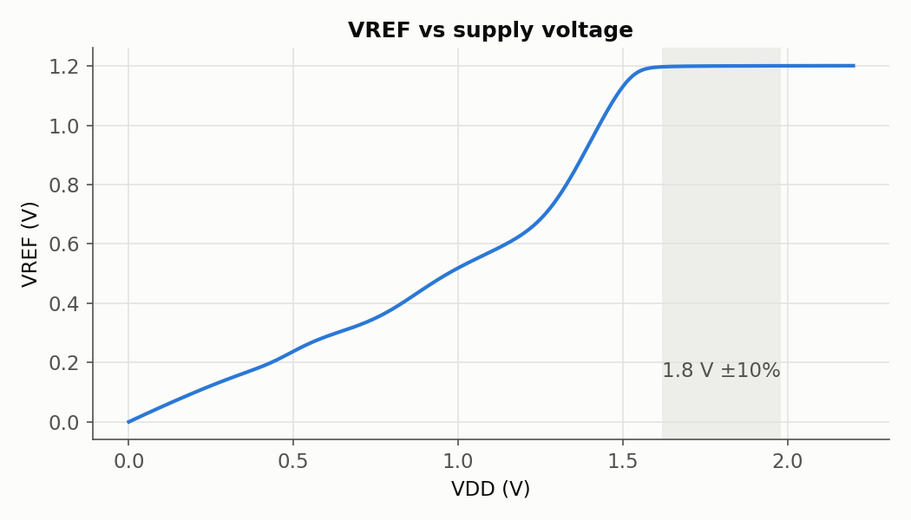
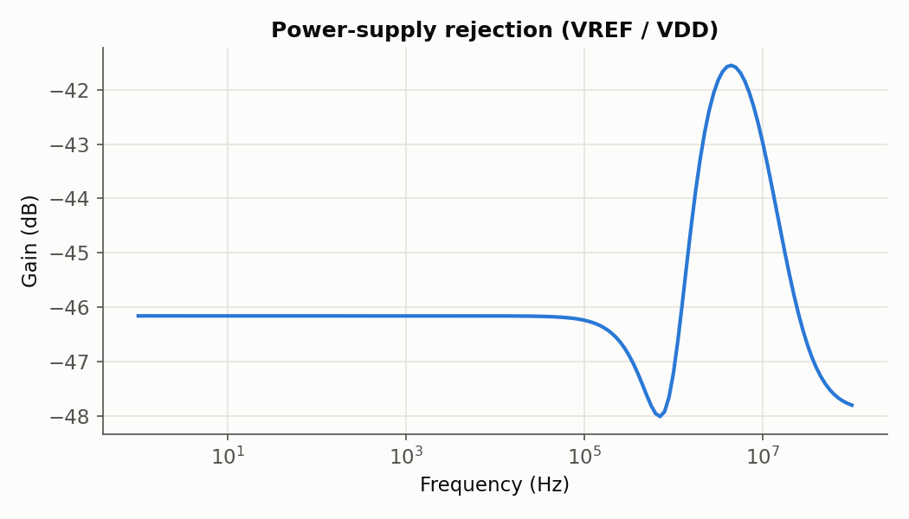
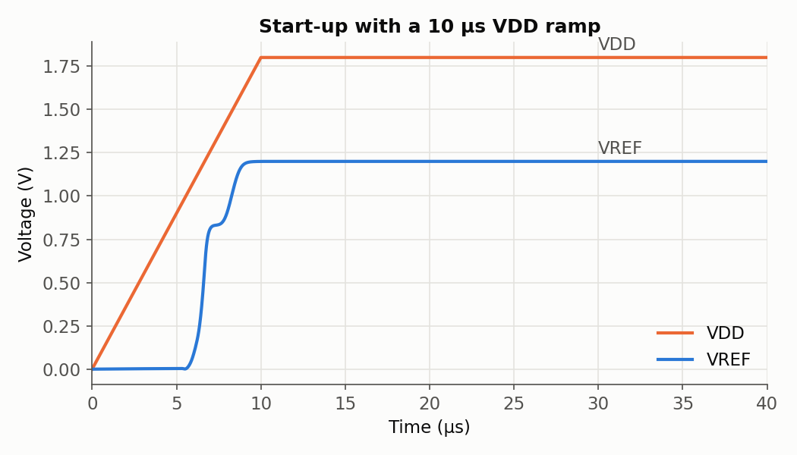
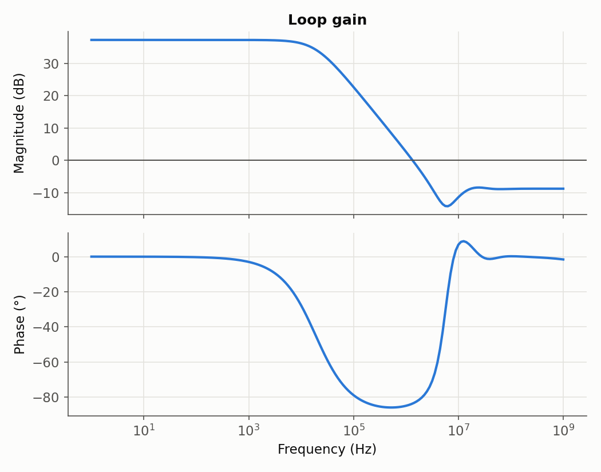
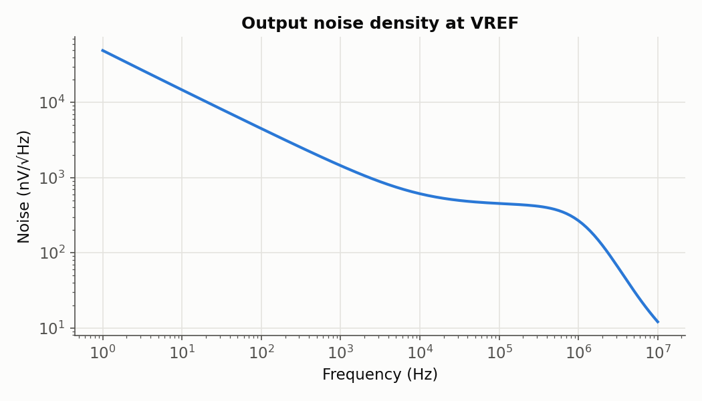
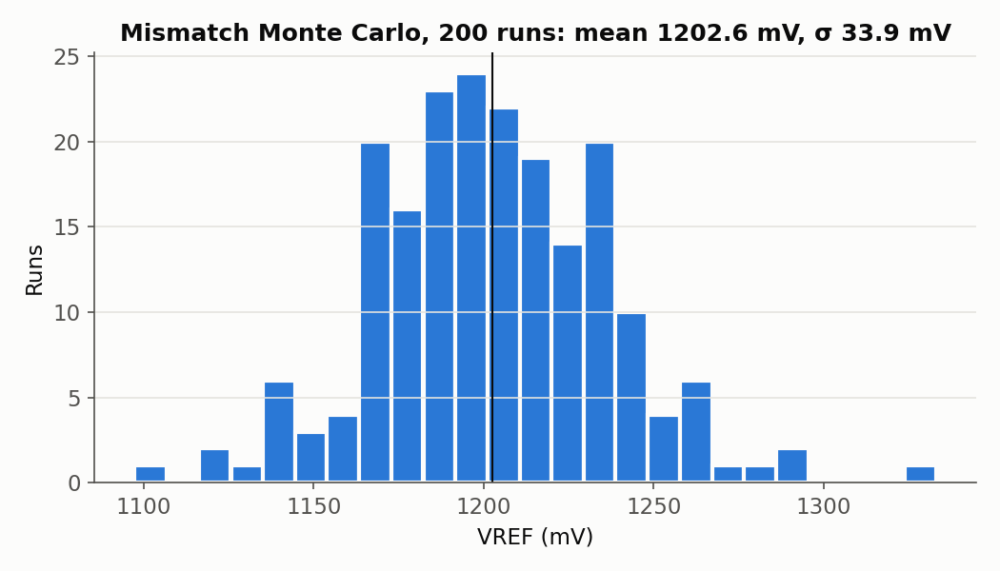

import SchematicViewer from '@site/src/components/SchematicViewer';
import Tabs from '@theme/Tabs';
import TabItem from '@theme/TabItem';

# Bandgap Reference

:::info[Summary]

**Process:** sky130 (130 nm) · **Tools:** xschem, ngspice, KLayout · **Status:** schematic and simulation done, no layout yet.
VREF is 1.200 V at 27 °C from a 1.8 V supply. All numbers below are pre-layout simulation in the typical (tt) corner unless noted.

:::

## Overview

A bandgap reference produces a voltage that barely moves with temperature, supply, or process.
It works by adding two voltages with opposite temperature slopes. The base-emitter voltage of a
bipolar transistor, $V_{BE}$, falls by about 2 mV/°C. The difference between the $V_{BE}$ of two
transistors run at different current densities, $\Delta V_{BE}$, rises in proportion to absolute temperature (PTAT).
Scaled correctly, the sum is flat to first order. That flat value sits near the silicon bandgap
voltage, which is where the name comes from.

| Parameter | Target | Simulated |
|---|---|---|
| Supply | 1.8 V | 1.8 V (works down to 1.57 V) |
| VREF at 27 °C | 1.2 V | 1.1998 V |
| Temperature drift, −40 to 125 °C | | 15.3 mV, 77 ppm/°C |
| Process corners (tt/ss/ff/sf/fs), VREF at 27 °C | | 1.1975 to 1.2007 V |
| Mismatch, 200-run Monte Carlo | | σ ≈ 30 to 35 mV |
| Line regulation, 1.62 to 1.98 V | | 9.4 mV/V |
| PSRR, DC to 1 MHz | | −46 dB |
| Supply current | | 20 µA (36 µW) |
| Start-up | must start unaided | settles 9 µs into a 10 µs VDD ramp |
| Loop stability | phase margin above 60° | 37 dB gain, 1.3 MHz crossover, 96° margin |

## Theory

Two diode-connected PNPs carry the same current $I$. Q2 is eight unit devices in parallel, so its
current density is eight times lower and its $V_{BE}$ is smaller by

$$
\Delta V_{BE} = V_{BE1} - V_{BE2} = V_T \ln 8, \qquad V_T = \frac{kT}{q} \tag{1}
$$

An error amplifier forces the two branch voltages $V_A$ and $V_B$ to be equal, which puts all of
$\Delta V_{BE}$ across R1. That sets a PTAT bias current:

$$
I = \frac{V_T \ln 8}{R_1} \tag{2}
$$

A third PMOS copies $I$ into R2 and a third unit PNP, Q3:

$$
V_{REF} = V_{BE3} + \frac{R_2}{R_1} V_T \ln 8 \tag{3}
$$

The first term falls with temperature and the second rises. The ratio $R_2/R_1$ sets the balance,
and since it's a ratio of matched resistors, the absolute resistor value cancels out.
Here $R_1$ = 11.4 kΩ and $R_2$ = 101 kΩ, a ratio of 8.85, giving $I$ ≈ 4.7 µA per branch.

The $V_{BE}$ slope isn't perfectly linear, so a first-order bandgap always leaves a slight bow in its
curve. The ratio that puts VREF at exactly 1.200 V places the peak of that bow near −35 °C,
not mid-range. Lengthening R2 trades a higher VREF for a flatter curve:

| R2 length | VREF at 27 °C | Drift (−40 to 125 °C) |
|---|---|---|
| 17.7 µm (this design) | 1.200 V | 77 ppm/°C |
| 18.35 µm | 1.218 V | 36 ppm/°C |

## Schematic 1: the internal design

<SchematicViewer file="bandgap_core.svg" />

The core (`xschem/bandgap_core.sch`) has four blocks:

- **PTAT core.** PMOS mirror M1 to M3 (8/4 µm) feeds Q1 (1×), R1 + Q2 (8×) and R2 + Q3 (1×).
  The PNPs are the sky130 `pnp_05v5_W3p40L3p40`, the same vertical PNP as the
  [BJT page](../bjt/index.mdx). The resistors are `res_xhigh_po_0p35` poly, about 2 kΩ/sq.
- **Error amplifier.** A five-transistor OTA with an NMOS-LVT input pair (M5, M6), a PMOS
  mirror load (M7, M8) and tail M4. The PMOS load matters. The OTA output drives the PMOS mirror
  gates, which must track VDD, and a PMOS load references the output to VDD, so it does that on its own.
  A first version with PMOS inputs and an NMOS load managed only −20 dB of PSRR.
  The inputs are LVT devices because $V_A$ and $V_B$ sit near 0.7 V, too low for a standard-VT pair to keep its tail in saturation.
  The input wired to B (the side with R1) goes to the amplifier's diode side, which makes the overall loop negative feedback.
- **Bias.** M12 and M13 copy the PTAT current into an NMOS diode that biases the tail.
  The whole circuit is self-biased, with no external current.
- **Start-up.** Every self-biased reference has a second stable state where no current flows.
  The weak, always-on M9 pulls node S high. While VREF is low, M11 pulls PB down and current starts flowing.
  Once VREF rises, M10 pulls S low and M11 turns off, so the start-up circuit is idle in normal operation.

C1 (a 30 × 30 µm MIM cap, about 1.8 pF) is the dominant-pole compensation on the amplifier output.
**Vloop** is a 0 V source between the amplifier output (PBO) and the mirror gates (PB). It does nothing
in normal simulation, and the stability test injects its AC signal there. The LVS netlist script replaces it with a short.

## Schematic 2: the cell under test

<SchematicViewer file="bandgap_tb.svg" />

`xschem/bandgap_tb.sch` uses the core as a single symbol (`bandgap_core.sym`, with pins VDD, VSS and VREF) and adds only the outside world:

- **VSUP:** one supply source that carries DC (`vdd`, default 1.8 V), AC 1 V for PSRR,
  and a PWL ramp from 0 V that only the transient start-up test uses.
- **CL:** a 1 pF load on VREF.
- **MODELS / CONTROL:** the sky130 model library and a quick operating point plus temperature sweep, so **Netlist → Simulate** in xschem works straight away.

The output is unbuffered: VREF comes straight from the R2 branch, so it can't drive a resistive load.
A real system would add a unity-gain buffer or LDO after it.

## Simulations

Every test lives in `sim/bandgap/`. The decks share `bench.spice`, the same circuit as the
testbench schematic. `run_all.sh` first netlists the schematic with xschem, so the tests always
simulate exactly what is drawn.

```bash
sim/bandgap/run_all.sh          # netlist + all tests (about 1 minute); logs and data in sim/bandgap/out/
python3 sim/bandgap/plot.py     # regenerate the plots on this page
ngspice sim/bandgap/temp.spice  # or run one deck interactively (after run_all.sh)
```

| # | Deck | What it checks | Result (tt, 27 °C) |
|---|---|---|---|
| 1 | `op.spice` | Operating point, supply current, amplifier offset $V_A - V_B$ | 1.1998 V, 20 µA, 0.10 mV |
| 2 | `temp.spice` | DC sweep −40 to 125 °C, box-method TC | 15.3 mV, 77 ppm/°C |
| 3 | `line.spice` | VDD swept 0 to 2.2 V | 9.4 mV/V; minimum VDD 1.57 V |
| 4 | `psrr.spice` | AC from VDD to VREF, 1 Hz to 100 MHz | −46 dB to 1 MHz |
| 5 | `startup.spice` | Transient with a 10 µs VDD ramp from 0 V | settles at 9.1 µs |
| 6 | `loop.spice` | Loop gain, injected at Vloop | 37 dB, 1.34 MHz, PM 96° |
| 7 | `noise.spice` | Output noise density, 1 Hz to 10 MHz | 1.4 µV/√Hz at 1 kHz; 464 µV rms total |
| 8 | `temp.spice` × 5 | Temperature sweep at tt, ss, ff, sf, fs | 71 to 82 ppm/°C |
| 9 | `mc.spice` | 200 mismatch samples (`tt_mm`), each powered up by the VDD ramp | mean ≈ 1.20 V, σ ≈ 30 to 35 mV |

<Tabs>
  <TabItem value="temp" label="Temperature">
    
  </TabItem>
  <TabItem value="line" label="Supply">
    
  </TabItem>
  <TabItem value="psrr" label="PSRR">
    
  </TabItem>
  <TabItem value="startup" label="Start-up">
    
  </TabItem>
  <TabItem value="loop" label="Loop gain">
    
  </TabItem>
  <TabItem value="noise" label="Noise">
    
  </TabItem>
  <TabItem value="mc" label="Monte Carlo">
    
  </TabItem>
</Tabs>

Notes on the tests:

- **Models.** The decks use the PDK's `combined` model library, the one xschem's sky130 setup points to.
  The older `libs.tech/ngspice` library gives a VREF about 27 mV lower for the same circuit.
- **DC hint.** `bench.spice` sets `.nodeset v(VREF)=1.2`. Without it, the DC temperature sweep can
  converge to a nonphysical solution. The start-up and Monte Carlo tests run in the time domain, so they still
  check that the circuit reaches its operating point unaided.
- **Monte Carlo** results change slightly between runs, because ngspice draws new random values each time.

## DRC and LVS with KLayout

There's no bandgap layout yet, but the checking flow is ready. The scripts wrap the decks that ship
with the PDK in `$PDK_ROOT/sky130A/libs.tech/klayout/`: `drc/sky130A_mr.drc` (manufacturing rules) and
`lvs/sky130.lvs`. Each deck runs through KLayout in batch mode as `klayout -b -r <deck> -rd name=value …`.

```bash
# DRC: front-end, back-end and off-grid rules; prints violations per rule
scripts/run_drc.sh gds/bandgap.gds BANDGAP

# LVS: netlists the schematic for LVS, extracts the layout, compares; exit status 0 = match
scripts/run_lvs.sh gds/bandgap.gds BANDGAP xschem/bandgap_core.sch

# Only the LVS netlist (top level as a .subckt, simulation-only parameters removed, 0 V probes shorted)
scripts/lvs_netlist.sh xschem/bandgap_core.sch
```

Each script writes a database you can open in KLayout to see every error on the layout:

- **DRC** writes `drc/<cell>_drc.lyrdb`. Open it in **Tools → Marker Browser**.
- **LVS** writes `lvs/<cell>.lvsdb`. Open it in **Tools → Netlist Browser**. It also writes the netlist extracted from the layout, `lvs/<cell>_extracted.cir`.

I tried the scripts on the existing [inverter](../inverter/index.mdx) layout, which is illustrative:

- **DRC** ran in about 1.5 s and found 9 violations in 2 rules (`ct.2` mcon spacing and `li.5` licon enclosure).
- **LVS** extracted both transistors with the right W and L and reported a mismatch. That's correct: the
  layout has no pin labels and its drains aren't connected.

I haven't yet shown LVS passing on a clean layout.
The PDK's KLayout transistor generators need `gdsfactory`, which isn't installed here, so the first clean-layout run will come with the bandgap layout.

## Known limitations and next steps

- **Mismatch dominates accuracy.** σ ≈ 30 to 35 mV (about 3 %) is much larger than the temperature drift.
  Offset in the amplifier and the PMOS mirror is multiplied by about $1 + R_2/R_1$ ≈ 10 on its way to the output.
  Larger devices, common-centroid layout, or a trim on R2 would bring it down.
- **Noise** is high for the same reason: amplifier flicker noise sees the same gain. Larger input devices, or chopping, would help.
- **Loop gain** is 37 dB with a single-stage amplifier. That sets the 46 dB PSRR. A cascoded or two-stage amplifier would improve both.
- **Layout:** the next step. Q2 goes in a common-centroid array of nine PNPs (eight plus Q1 in the centre), R1 and R2 are built from matched unit resistors,
  and the mirror is interdigitated. Then the layout goes through DRC and LVS with the scripts above.

## References

1. B. Razavi, *Design of Analog CMOS Integrated Circuits*, 2nd ed., McGraw-Hill, 2017, ch. 12 (bandgap references).
2. P. R. Gray, P. J. Hurst, S. H. Lewis, R. G. Meyer, *Analysis and Design of Analog Integrated Circuits*, 5th ed., Wiley, 2009, ch. 4.
3. SkyWater, *SKY130 PDK documentation*, https://skywater-pdk.readthedocs.io
4. KLayout, *DRC and LVS reference*, https://www.klayout.de/doc/manual/lvs.html
