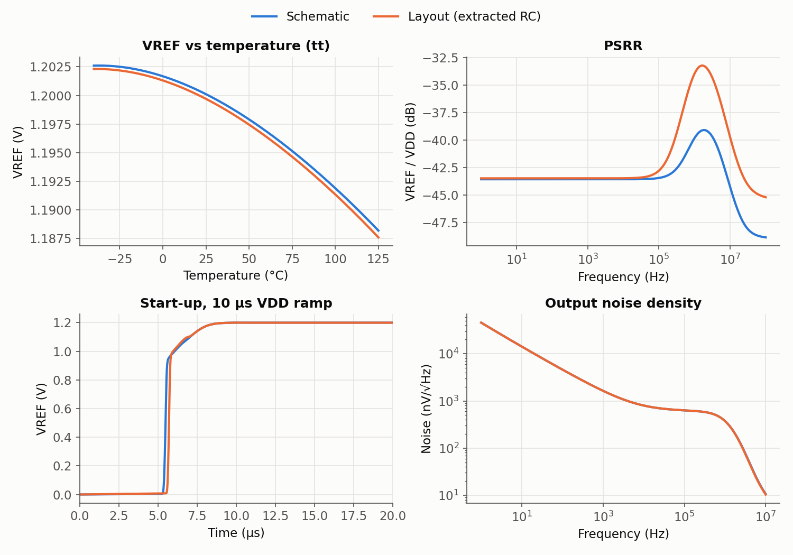

# Bandgap Post-Layout Simulation

The [layout](./layout.mdx)'s parasitic resistance and capacitance were extracted and run through the same test decks as the
schematic on the [Simulations](./simulations.mdx) page.

**Extraction.** I used [KLayout-PEX](https://github.com/iic-jku/klayout-pex) (`kpex`) with its 2.5D engine in RC mode.
The usual open-source extractor, magic, can't run here: the installed magic (8.3.105) is older than the one the PDK's
technology file was written for, and it crashes loading it. kpex runs on KLayout 0.30, newer than the system's 0.28, so a copy of the
official 0.30.13 package sits in `~/opt` just for it.

The extracted netlist has 4,454 resistors, 8,492 capacitors and all 27 transistors, resistors and PNPs. kpex represents the MIM cap
as extracted plate capacitance, not as a device. Adding it up gives **1,835 fF** between PB and VDD, against the 1.82 pF designed.
The wiring adds only 5 to 28 fF per net to the substrate.

```bash
sim/bandgap/pex/run_pex.sh            # simulate the committed extracted netlist, compare with the schematic
sim/bandgap/pex/run_pex.sh --extract  # re-extract from gds/bandgap.gds first (about 6 minutes)
```



| tt, 27 °C | Schematic | Layout (extracted RC) |
|---|---|---|
| VREF | 1.2000 V | 1.1995 V |
| Supply current | 20.07 µA | 20.03 µA |
| Temperature drift, −40 to 125 °C | 72.8 ppm/°C | 74.3 ppm/°C |
| Corners (tt/ss/ff/sf/fs), VREF at 27 °C | 1.1974 to 1.2009 V | 1.1970 to 1.2005 V |
| Line regulation | 9.9 mV/V | 9.95 mV/V |
| Minimum VDD | 1.514 V | 1.517 V |
| PSRR at 10 kHz | −43.6 dB | −43.5 dB |
| **PSRR at 1 MHz** | **−39.8 dB** | **−34.0 dB** |
| Start-up settle | 8.44 µs | 8.44 µs |
| Output noise, 1 Hz to 10 MHz | 629 µV rms | 628 µV rms |

The layout costs half a millivolt of VREF and almost nothing in drift, supply range, start-up or noise. The one real loss is supply rejection
between about 100 kHz and 10 MHz: the PSRR peak near 2 MHz rises from −39 to −33 dB.

**Finding the cause.** I re-ran the PSRR test with one kind of parasitic removed at a time:

| Variant of the extracted netlist | PSRR at 1 MHz |
|---|---|
| Full extraction | −34.0 dB |
| Wire resistance shorted out | −33.9 dB |
| All parasitic capacitance removed (MIM cap kept) | −39.9 dB |
| Only VDD's coupling into other nodes removed | −33.5 dB |
| **Only PB's capacitance to ground removed** | **−45.0 dB** |

PB drives the gates of every PMOS mirror, so it must follow VDD exactly, and the 1.8 pF cap from PB to VDD makes it do so at high frequency.
The ~14 fF from PB's wiring to the substrate is a small capacitive divider toward ground. Above the loop's
1 MHz crossover, the amplifier can no longer correct it. That's less than 1 % of the main cap, but it sets the high-frequency PSRR.
Possible fixes are routing PB on higher metal (less capacitance to the substrate), keeping PB's wiring short,
or a larger cap from PB to VDD.

Two parts of the schematic test suite don't carry over:

- **Loop gain:** the 0 V injection source exists only in the schematic; in the layout it's a wire. The start-up transient settles cleanly, with no ringing.
- **Monte Carlo mismatch:** about 2 s per sample on the 13,000-element netlist; not run yet.

Extraction details:

- **Isolated tap pieces.** kpex's technology data doesn't recognise the PNP's tap rings, so a few tap pieces end up tied only through capacitors.
  The bench adds a 10¹² Ω shunt from every node to ground (`rshunt`) to give them a DC value.
- **Substrate.** It's a separate port (`sky130_gnd`), tied to ground in the bench, as it is on the chip.
- **Starting guess.** Every routed net is labelled in the layout, so the extracted netlist keeps the schematic's names.
  The DC solver can then be given the same starting guess (PB, A, B) as in schematic simulation.
  Without it, the first post-layout operating point converged to VREF = −1,192 V.
