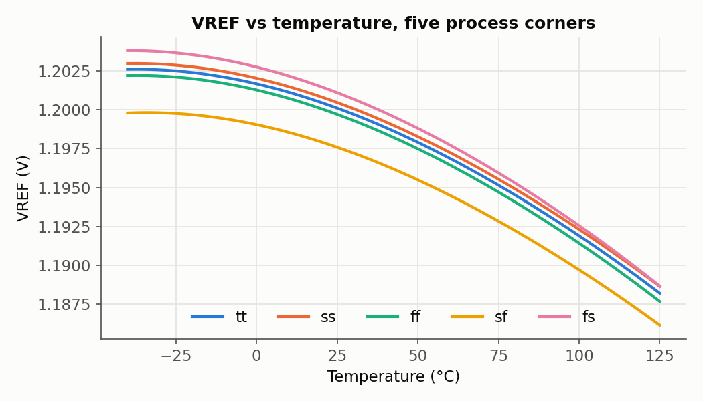
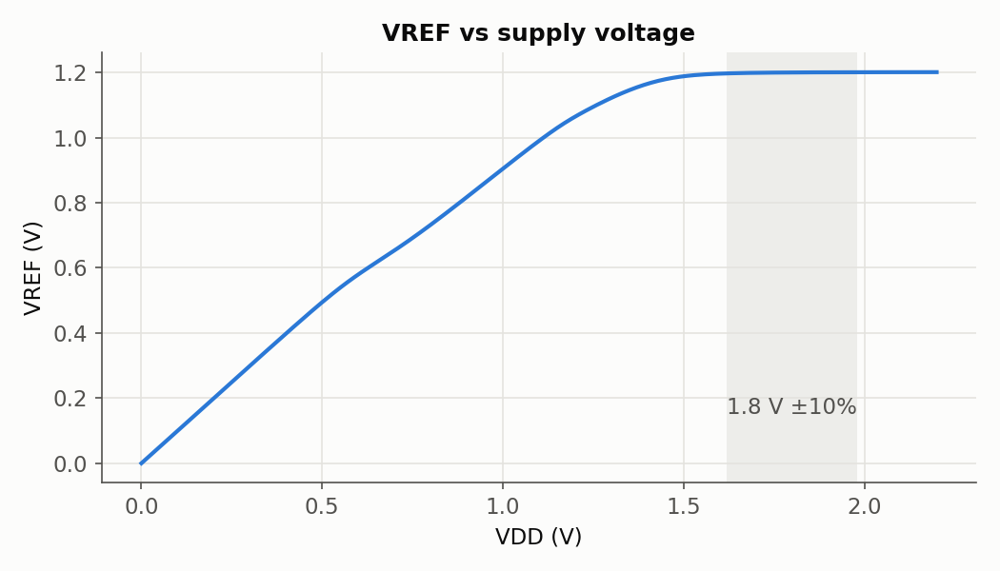
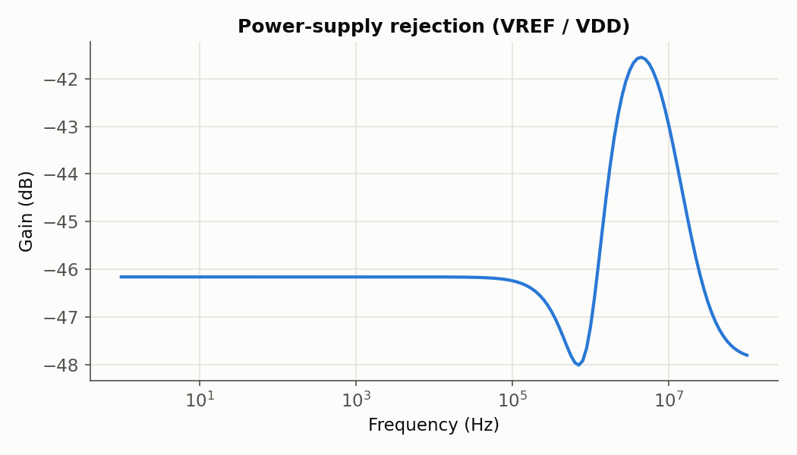
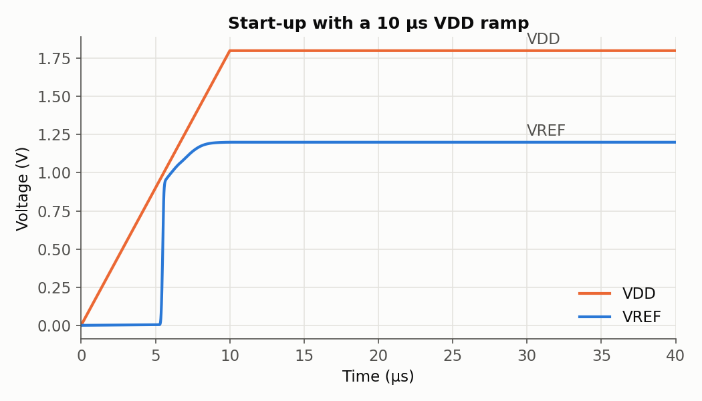
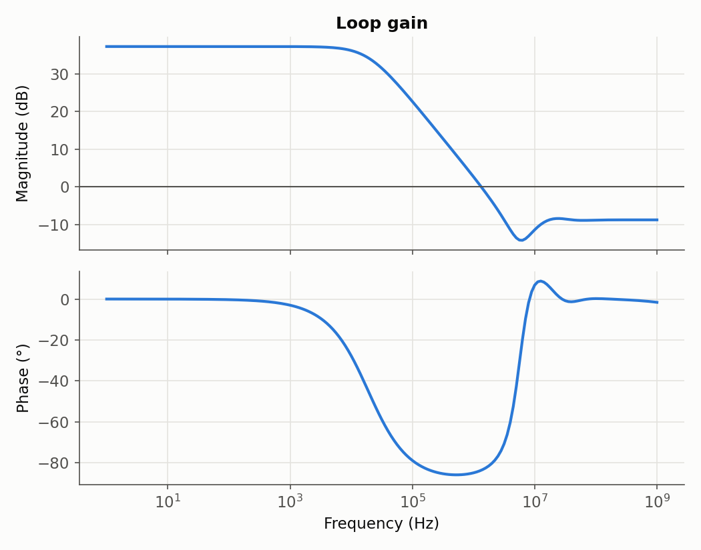
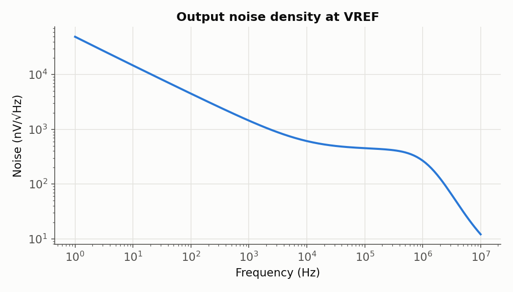
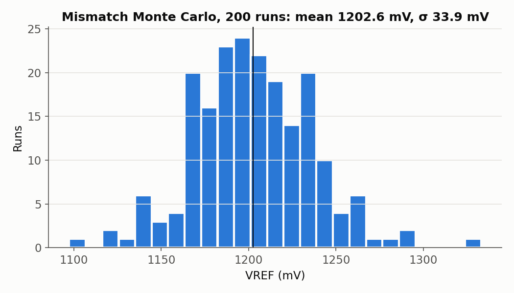

import Tabs from '@theme/Tabs';
import TabItem from '@theme/TabItem';
import SchematicViewer from '@site/src/components/SchematicViewer';

# Bandgap Simulations

The schematic test suite for the [bandgap reference](./index.mdx). How the results drove the design is in the [design log](./design-log.mdx).

## The cell under test

<SchematicViewer file="bandgap_tb.svg" />

`xschem/bandgap_tb.sch` uses the core as a single symbol (`bandgap_core.sym`, with pins VDD, VSS and VREF) and adds only the outside world:

- **VSUP:** one supply source that carries DC (`vdd`, default 1.8 V), AC 1 V for PSRR,
  and a PWL ramp from 0 V that only the transient start-up test uses.
- **CL:** a 1 pF load on VREF.
- **MODELS / CONTROL:** the sky130 model library and a quick operating point plus temperature sweep, so **Netlist → Simulate** in xschem works straight away.

The output is unbuffered: VREF comes straight from the R2 branch, so it can't drive a resistive load.
A real system would add a unity-gain buffer or LDO after it.

## Schematic test suite

Every test lives in `sim/bandgap/`. The decks share `bench.spice`, the same circuit as the
testbench schematic. `run_all.sh` first netlists the schematic with xschem, so the tests always
simulate exactly what is drawn.

```bash
sim/bandgap/run_all.sh          # netlist + all tests (about 1 minute); logs and data in sim/bandgap/out/
python3 sim/bandgap/plot.py     # regenerate the plots on this page
ngspice sim/bandgap/temp.spice  # or run one deck interactively (after run_all.sh)
```

| # | Deck | What it checks | Result (tt, 27 °C) |
|---|---|---|---|
| 1 | `op.spice` | Operating point, supply current, amplifier offset $V_A - V_B$ | 1.2000 V, 20 µA, 0.04 mV |
| 2 | `temp.spice` | DC sweep −40 to 125 °C, box-method TC | 14.4 mV, 73 ppm/°C |
| 3 | `line.spice` | VDD swept 0 to 2.2 V | 9.9 mV/V; minimum VDD 1.51 V |
| 4 | `psrr.spice` | AC from VDD to VREF, 1 Hz to 100 MHz | −44 dB to 10 kHz, −40 dB at 1 MHz |
| 5 | `startup.spice` | Transient with a 10 µs VDD ramp from 0 V | settles at 8.4 µs |
| 6 | `loop.spice` | Loop gain, injected at Vloop | 36 dB, 1.1 MHz, PM 89° |
| 7 | `noise.spice` | Output noise density, 1 Hz to 10 MHz | 1.6 µV/√Hz at 1 kHz; 629 µV rms total |
| 8 | `temp.spice` × 5 | Temperature sweep at tt, ss, ff, sf, fs | 69 to 76 ppm/°C |
| 9 | `mc.spice` | 200 mismatch samples (`tt_mm`), each powered up by the VDD ramp | mean ≈ 1.20 to 1.21 V, σ ≈ 45 to 50 mV |
| 10 | `sat.spice` | Every transistor's $\lvert V_{DS} \rvert$ against $V_{DSAT}$, at 1.8 and 1.62 V, run at −40, 27 and 125 °C | all analog devices saturated; worst margin 0.11 V |

<Tabs>
  <TabItem value="temp" label="Temperature">
    
  </TabItem>
  <TabItem value="line" label="Supply">
    
  </TabItem>
  <TabItem value="psrr" label="PSRR">
    
  </TabItem>
  <TabItem value="startup" label="Start-up">
    
  </TabItem>
  <TabItem value="loop" label="Loop gain">
    
  </TabItem>
  <TabItem value="noise" label="Noise">
    
  </TabItem>
  <TabItem value="mc" label="Monte Carlo">
    
  </TabItem>
</Tabs>

Notes on the tests:

- **Models.** The decks use the PDK's `combined` model library, the one xschem's sky130 setup points to.
  The older `libs.tech/ngspice` library gives a VREF about 27 mV lower for the same circuit.
- **DC hints.** A self-biased circuit has more than one DC solution, and the solver doesn't always find the right one.
  `bench.spice` sets `.nodeset` guesses for VREF, PB, A and B. The temperature sweep runs outward from
  27 °C in both directions, because a single −40 to 125 °C sweep jumped to an unstable solution near 1.7 V at three corners.
  That state isn't real: a transient started from it falls back to 1.2 V. The start-up and Monte Carlo tests
  run in the time domain without these hints, so they check that the circuit reaches its operating point unaided.
- **`sat.spice`** is generated by `make_sat.py` from the netlist, so it always covers every transistor in the schematic.
- **Monte Carlo** results change slightly between runs, because ngspice draws new random values each time.

The same tests on the extracted layout are on [Post-layout simulation](./post-layout.mdx).
